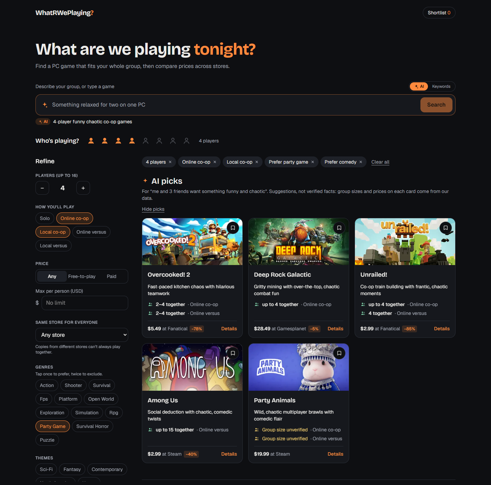
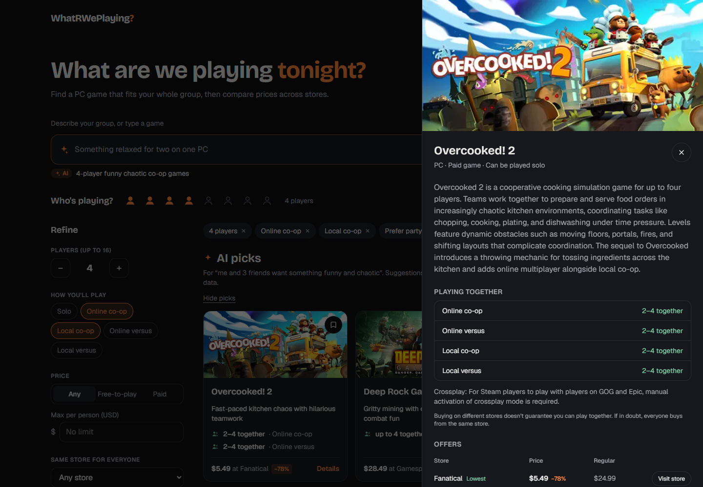

# WhatRWePlaying

Find a PC game your whole group can actually play together, then see where it's cheapest.



## What it does

- **Describe your group in plain words.** "Four of us, online co-op, nothing scary, under $15 each"
  sets the filters for you. Follow up with "actually, cheaper" and only that part changes.
- **AI picks.** Ask for a mood ("a solo game with a great story") and the AI suggests games from
  any PC game, each with a short reason. Every pick is checked to exist before it's shown.
- **Real group sizes.** Player counts mean how many friends can play together in one party or
  lobby, not the size of a public match. If we can't confirm it, the card says so.
- **Search any game by name**, with suggestions as you type, even with typos ("monstr huntr").
- **Compare prices** across Steam, Epic, GOG, Humble, Fanatical and more, in USD.
- **Save a shortlist** and send it to friends as a link. No account needed.



## How it works

| | Source |
|---|---|
| Group sizes, play modes, genres | [PCGamingWiki](https://www.pcgamingwiki.com), plus hand-checked party sizes with sources |
| Descriptions, artwork, search for other games | [IGDB](https://www.igdb.com) |
| Prices | [CheapShark](https://www.cheapshark.com), fetched live in your browser |
| AI search and picks | [Groq](https://groq.com) (`openai/gpt-oss-20b`) |

The catalogue has 80 games, from Steam and from other launchers like Riot and Epic.
The AI only turns your words into filters and game names. Group sizes, prices and links always
come from the data above, never from the AI.

## Run it locally

```bash
npm install
cp .env.example .env.local
npm run dev
```

The app works without any keys. Add them to `.env.local` to turn on more:

| Variable | Turns on |
|---|---|
| `GROQ_API_KEY`, `GROQ_MODEL` | AI search and picks ([free key](https://console.groq.com/keys)) |
| `TWITCH_CLIENT_ID`, `TWITCH_CLIENT_SECRET` | Search across every PC game ([register an app](https://dev.twitch.tv/console/apps)) |

Other commands: `npm test` (unit tests), `npm run build`, and `npm run sync` to rebuild the
catalogue from `data/seed.json`.

## Limits

- PC only. Prices are in USD and may differ from your regional price.
- Stores CheapShark doesn't track (EA app, Battle.net, Riot) show a link instead of a price.
- Group sizes come from a community wiki and a few reviewed sources, so mistakes are possible.
  Each game lists its sources.
- The free AI tier handles a few searches a minute; when it's busy, a keyword search takes over.

## Built with

Next.js 16, React 19, TypeScript, Tailwind CSS 4, Zod and Vitest.

Game data from PCGamingWiki is licensed [CC BY-NC-SA 3.0](https://creativecommons.org/licenses/by-nc-sa/3.0/).
Game artwork belongs to its publishers. This is a non-commercial project.
