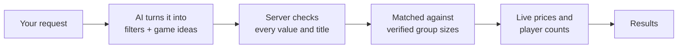

# WhatRWePlaying

Find a PC game your whole group can actually play together, then see where it's cheapest.

Most game sites tell you how many players a match holds. WhatRWePlaying tells you how many
friends can join the same party, checks it against real data, and shows the best current price,
all from one plain-English request like "four of us, co-op, nothing scary, under $15".

**Try it: [whatrweplaying.vercel.app](https://whatrweplaying.vercel.app)**

[](https://whatrweplaying.vercel.app)

## What it does

- **Describe your group in plain words.** "Four of us, online co-op, nothing scary, under $15 each"
  sets the filters for you. Follow up with "actually, cheaper" and only that part changes.
- **AI picks.** Ask for a mood ("a solo game with a great story") and the AI suggests games from
  any PC game, each with a short reason, how many can play together and its best price. Every
  pick is checked to exist before it's shown.
- **Real group sizes.** Player counts mean how many friends can play together in one party or
  lobby, not the size of a public match. 80 games are hand-checked with sources; for any other
  game the count comes from IGDB and is marked as not checked by us.
- **See what's popular right now.** By default, games are ordered by how many people are playing
  them at the moment, with live Steam player counts on the cards.
- **Search any game by name**, with suggestions as you type, even with typos ("monstr huntr").
- **Compare prices** across Steam, Epic, GOG, Humble, Fanatical and more, in USD.
- **Save a shortlist** and send it to friends as a link. No account needed.


## How it works



1. **You describe your group.** The AI ([Groq](https://groq.com)) reads your message and turns it
   into filters (how many of you, co-op or versus, mood, budget) and a few game ideas. In Keywords
   mode, or if the AI is busy, a simple keyword reader does the same job.
2. **The server checks the AI's answer.** Filters can only use known values, and each suggested
   game is looked up in our catalogue or on [IGDB](https://www.igdb.com). Anything that can't be
   found is dropped. API keys stay on the server.
3. **Your group is matched against verified data.** Our checked list of 80 games is built ahead
   of time from [PCGamingWiki](https://www.pcgamingwiki.com) plus hand-checked party sizes, each
   with a source. A game only counts as a match if it fits your group and the way you want to
   play; games we can't confirm go in a separate list instead of being guessed. Other games show
   IGDB's co-op group size, and an AI pick that IGDB says is too small for your group is hidden.
4. **Prices come in live.** Our server asks [CheapShark](https://www.cheapshark.com) for current
   offers and shares each answer with every visitor for a few minutes. Offers are matched by each
   game's Steam ID so DLC and other editions don't mix in.
5. **Results are ranked by what's popular now.** Equal matches are ordered by how many people are
   playing right now: Steam's live player counts, or IGDB's for games that aren't on Steam.

The AI only suggests. Group sizes, prices and store links always come from the sources above.

## Run it locally

```bash
npm install
cp .env.example .env.local
npm run dev
```

The app works without any keys. Add them to `.env.local` to turn on more:

| Variable | Turns on |
|---|---|
| `GROQ_API_KEY`, `GROQ_MODEL` | AI search and picks ([free key](https://console.groq.com/keys)) |
| `TWITCH_CLIENT_ID`, `TWITCH_CLIENT_SECRET` | Search across every PC game ([register an app](https://dev.twitch.tv/console/apps)) |

Other commands: `npm test` (unit tests), `npm run build`, and `npm run sync` to rebuild the
catalogue from `data/seed.json`.

## Limits

- PC only. Prices are in USD and may differ from your regional price.
- Stores CheapShark doesn't track (EA app, Battle.net, Riot) show a link instead of a price.
- Group sizes come from a community wiki and a few reviewed sources, so mistakes are possible.
  Each game lists its sources.
- The free AI tier handles a few searches a minute; when it's busy, a keyword search takes over.

## Built with

**App**


**Data and AI**


Game data from PCGamingWiki is licensed [CC BY-NC-SA 3.0](https://creativecommons.org/licenses/by-nc-sa/3.0/).
Game artwork belongs to its publishers. This is a non-commercial project.
